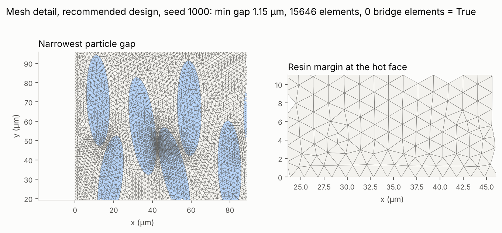
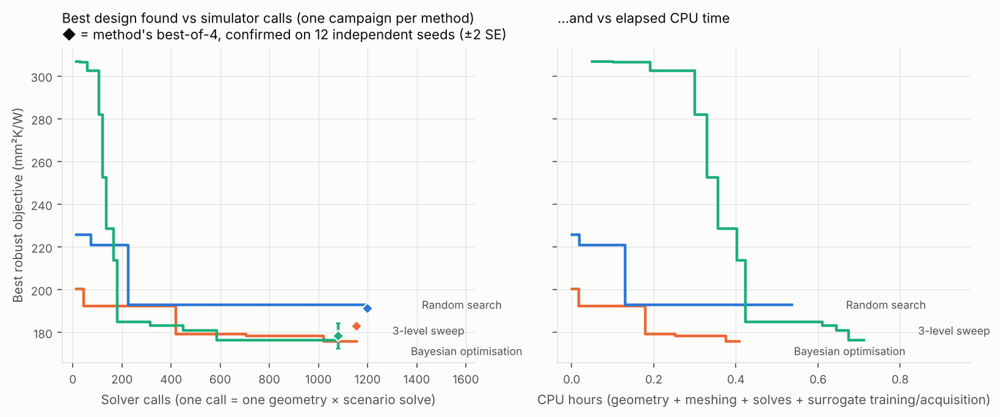
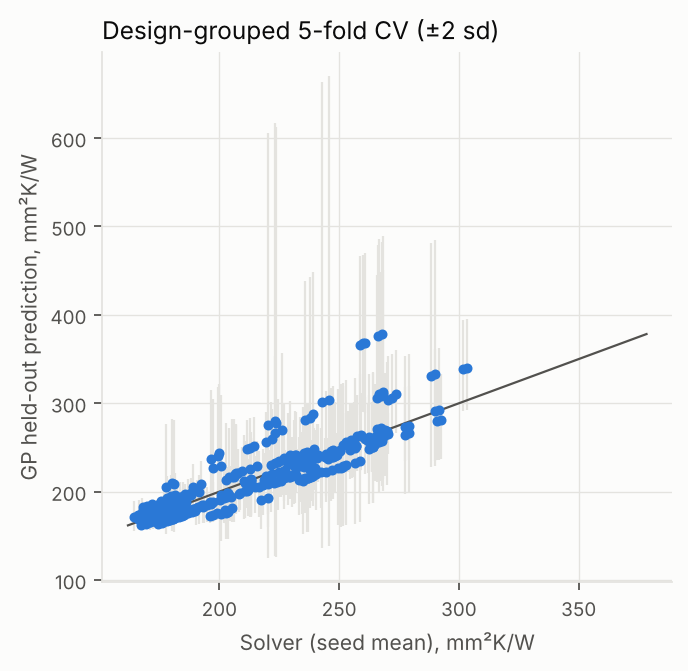
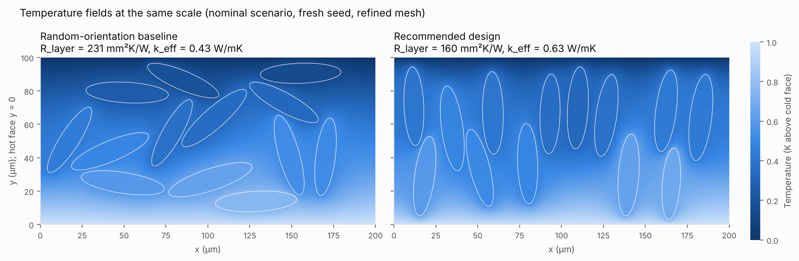
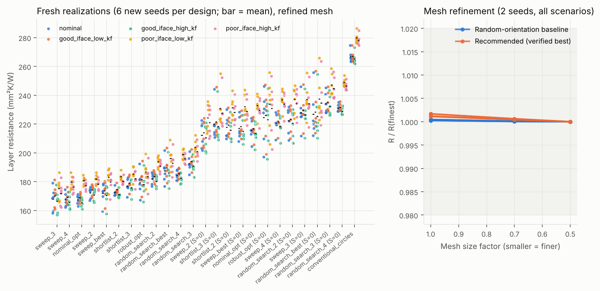
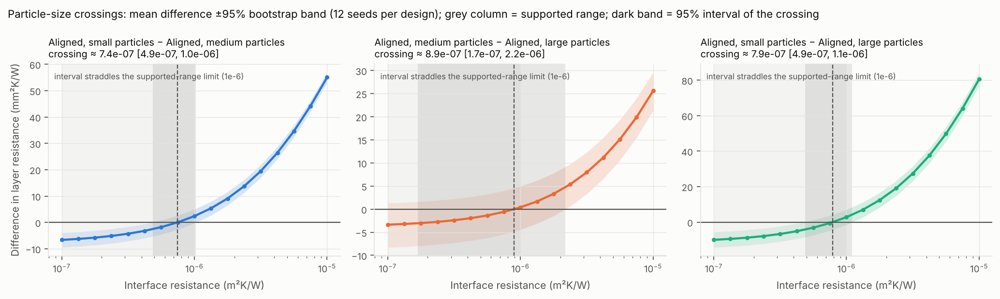
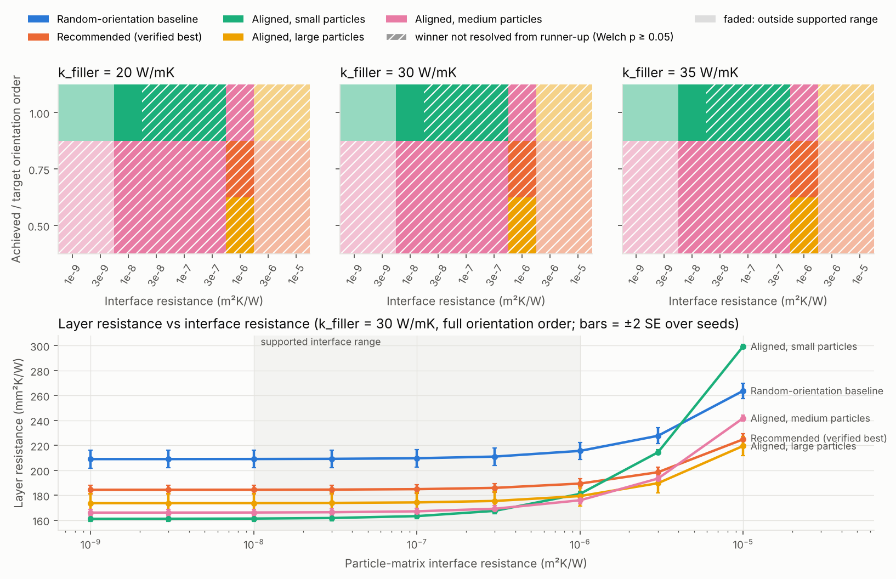
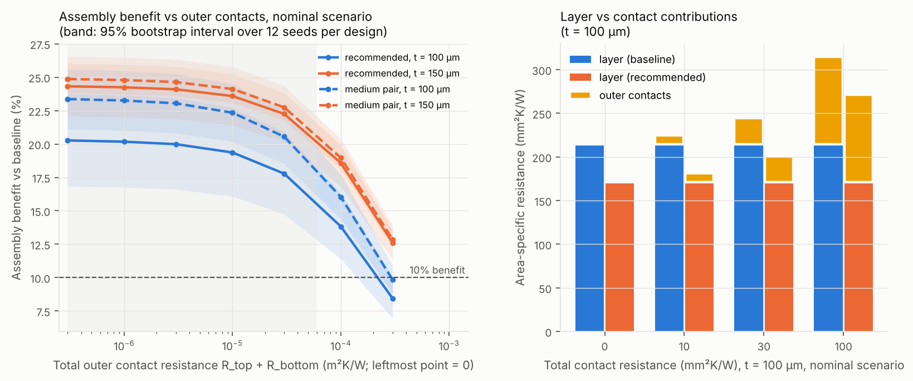
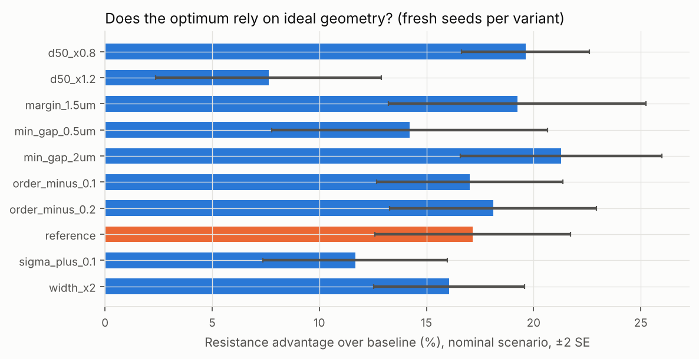

# Simulation-verified microstructure design study for particle-filled epoxy adhesive layers

**Phase 1 technical report: 2D verified solver and constrained design loop (development filler, not BN).**

> This is a simulation-based design study. No experimental confirmation exists. The filler is an isotropic alumina-like *development* stand-in, so no statement here is evidence about boron nitride. Electrical insulation is only the motivation for choosing ceramic fillers; the thermal solver says nothing about dielectric performance. No new commercial adhesive or semiconductor reliability is claimed.

## Summary of findings (Phase 1, 2D development case)

These findings describe a 2D layer, 100 µm thick, with filler area fraction 0.30 and an *assumed* alumina-like filler. They are not boron nitride results.

**How the evidence was produced.** Every number below comes from the result files and is repeated in the tables later in this report.

* Comparisons between designs use Welch tests on independent random particle arrangements ("seeds"), with Holm correction where a family of comparisons is made.
* Locations and thresholds are given with 95% bootstrap intervals.
* "Not resolved" means no difference was detected. It does not mean the designs are equivalent.
* The candidates were chosen on a 6-seed verification batch. Their quoted values come from a separate 12-seed confirmation batch, because the minimum of several noisy values is biased low.

**Revision note.** This revision follows an external review. Several earlier statements were weaker than they read: the size crossovers, the contact-resistance threshold, the claimed "statistical equivalence" of BO and the sweep, the uncertainty table, and the measurement-priority wording. Section 8 lists what changed.

1. **Aligning elongated particles is a large, well-resolved benefit. It is the one firm design conclusion.**
   * Every optimised candidate is elongated (aspect ratio 3.3–4) and at least partly aligned (orientation order 0.56–0.95). The eight BO and sweep candidates all have aspect ratio 4 and order 0.84–0.95.
   * Each one has 17–27% lower worst-case layer resistance than its own random-orientation counterpart with the same loading, sizes and shape (verification batch).
   * On the independent confirmation batch, the recommended design beats its matched baseline by 45 mm²K/W (95% CI 36–54), a 20% reduction.
   * The same comparison on the batch it was selected from gave 26%. The gap is a measured example of best-of-N selection bias.
   * Random circles at the same loading reach 280 mm²K/W. The confirmed BO and sweep candidates lie at 178–185.
2. **The evidence cannot choose among the aligned aspect-ratio-4 designs.**
   * The mechanical recommendation (lowest verification value) is median size 24 µm, width 0.05, aspect ratio 4, orientation order 0.95. It confirms at 178.5 ± 3.0 mm²K/W.
   * Seven of the eleven other optimised candidates are not resolved from it. These include the previous recommendation (6.7 µm), which confirms at 182.9 ± 0.8.
   * On the confirmation batch, every aligned candidate's 95% CI for its difference from the recommended design includes zero. Only the random-search pick is resolved worse (+12.9 mm²K/W, 95% CI 6.2–19.6).
   * The recommended design sits at a corner of the design space (largest size, narrowest width, highest aspect ratio and alignment). It also has the largest realization-to-realization spread. It cannot be used in a 50 µm layer (its particles do not fit), and its advantage falls to 0.44× when particle size is scaled up by 20%.
   * Among the unresolved designs, a ~10 µm design such as `sweep_best` (179.3 ± 0.9) is less variable and fits thinner layers. These are legitimate grounds for choosing between designs the simulation cannot separate.
3. **Particle size versus interface resistance: the direction is robust, the location is not.** (Q1; 12 seeds; dense grid)
   * The size ladder is 5, 11 and 20 µm, all with the recommended width, shape and alignment. Smaller sizes (4 and 4.5 µm) could not be packed at this loading and minimum gap.
   * At low interface resistance, smaller particles are better. As interface resistance rises, their penalty grows steadily. This trend is consistent across seeds and well resolved.
   * The estimated crossings, with 95% intervals:
     * small vs medium: 7.4e-7 m²K/W [4.9e-7, 1.0e-6]
     * small vs large: 7.9e-7 [4.9e-7, 1.1e-6]
     * medium vs large: 8.9e-7 [1.7e-7, 2.2e-6]; 9% of bootstrap resamples show no crossing at all.
   * All three intervals straddle the 1e-6 upper limit of the supported interface range. So the crossings sit near the top of that range but are **not established design boundaries**.
   * Random orientation never wins a cell of the design map. On the 3-seed map, 93% of supported-range cells do not resolve the winner from the runner-up.
4. **Outer contacts do not make the microstructure irrelevant in the assumed range, though the threshold is uncertain.** (Q2; same 12 seeds and mesh as the confirmation batch)
   * At 100 µm, the recommended design's assembly benefit is 20.3% [16.8, 23.8] with ideal contacts.
   * The benefit falls to 10% at a total contact resistance of 220 mm²K/W [144, 299] (nominal scenario), or 214 [138, 292] in the least favourable stress scenario. The threshold multiplies noise roughly tenfold, hence the wide interval.
   * Even its lower bound is more than twice the assumed realistic range (≤ 60 mm²K/W in total).
   * The earlier figure of 331 came from a separate 4-seed batch. It is not reproducible from the main table, and it has been replaced.
   * The threshold rises with thickness. For the medium pair it goes from 292 [238, 348] at 100 µm to 478 [438, 519] at 150 µm.
   * The pre-registered 50 µm comparison could not be made. The recommended distribution does not fit, and the medium pair failed to pack in 3 of 12 (aligned) and 7 of 12 (random) realizations.
   * The series formula R_top + R_layer + R_bottom underestimates Robin contact solves by up to 3.0% for the large-particle design (1.2% for the medium pair).
5. **Robustness of the recommended design to geometric perturbations.** (Q3; 12 seeds)
   * The reference advantage is 17.2% (t = 7.6).
   * It is insensitive to orientation: lowering the order by 0.1 or 0.2 gives 0.99× and 1.05× of the reference. The pre-registered "smooth decrease" was not observed, but neither was a collapse.
   * It is insensitive to minimum gap (0.82–1.26×), lateral domain width (0.95×) and a thinner margin (1.10×).
   * It is sensitive to larger particles (size ×1.2 gives 0.44×) and to a wider size distribution (0.69×).
   * A 6 µm resin margin could not be packed for this design.
6. **Which input each decision is sensitive to, conditionally.** (Q4)
   * Within the reference ranges, the spread of "baseline − candidate" (the value of aligning) is almost entirely explained by the achieved orientation: 98–100%. The interface and filler-conductivity shares are both ≈ 0%, so their relative order is not meaningful.
   * Widening the interface range to 1e-5 m²K/W moves the interface share to 18% (recommended design) and 39% (medium design).
   * For the size decision, the large − small difference varies only with interface resistance. But orientation was *not varied* there, because the small design could not be packed at reduced orientation.
   * These are sensitivity shares that depend on the chosen ranges, grid weighting and independence assumptions. They indicate which uncertainty matters to which decision. They do not say which measurement is worth buying, because measurement cost, accuracy and decision impact are not modelled.
7. **Search methods: one campaign each.**
   * Each method's best-of-four design was verified, then confirmed on 12 independent seeds: BO 182.9 ± 0.8, random search 191.4 ± 1.0, sweep 178.5 ± 3.0 mm²K/W.
   * BO is resolved better than random search in this campaign: random − BO = 8.4 mm²K/W [5.8, 11.1], Holm p < 0.001.
   * The sweep comparison is unresolved: sweep − BO = −4.5 [−11.1, +2.2]. The sweep also reached within 1% of the best loop value in fewer solver calls (585 vs 1020).
   * Because each method ran once, none of this generalises to the methods themselves, and "unresolved" is not equivalence. Following the guide, the cheaper sweep is retained for Phase 1.
   * The GP surrogate met the 5% held-out target (4.1% median), but its 95% intervals covered only 85% of points. A small extra-trees ensemble was more accurate (1.8%).

### Phase 2 gate

The gate is **not passed**, for two reasons:

* the BN material case and BN tensor (SR-001, SR-009) are still pending extraction;
* the loop's top-ranked finalist did not keep first place on fresh seeds, although it is not resolved from the verified best.

### Notes on the hypothesis evaluation

The hypotheses are graded mechanically against intervals.

* **H1** has one unresolved clause, because every crossing interval straddles 1e-6.
* **H2**'s thickness clause is untestable at 50 µm. The trend between 100 and 150 µm is resolved.
* **H3** is only partly supported because the predicted decrease with orientation did not appear, even though no collapse occurred.
* **H4** holds for the reference ranges. The interface-versus-filler part is trivially ordered, since both shares are ≈ 0.
* **H5** holds for this single campaign only.

The scenarios are hand-chosen stress cases, so every "worst case" above is a stress statement, not a reliability estimate.

### 8 What changed after the external review

| Review point | Change |
|---|---|
| Crossovers stated more strongly than the evidence | A dense 17-point grid with 12 seeds per design and bootstrap intervals on each crossing location. Crossings are reported as estimates with intervals; points above the supported range are labelled as stress cases. |
| Contact threshold not reproducible from the main table | Q2 recomputed from the confirmation seeds and mesh, with layer resistances shown, bootstrap intervals on the benefit and the threshold, and a second design pair for the thickness trend. |
| "Statistically equivalent" claims | Removed. Methods are compared on an independent confirmation batch, and each verified the same number (4) of candidates. Statements are limited to this single campaign. |
| Self-comparison row and the "2 SE" rule | The self-comparison is removed. Welch tests with Holm correction replace the 2 SE screen; confirmation-batch values are quoted to remove selection bias. |
| Measurement-priority wording | Reframed as conditional sensitivity shares, with range variants that show how the shares move; no measurement recommendation is made. |
| Verification ahead of validation | Unchanged and agreed: all properties remain assumed, and Phase 2 (BN case, 3D platelets) is required before any material claim. |

## 1 Physical model

* Steady linear conduction, no heat generation: q = −K∇T, ∇·(K∇T) = 0. Epoxy is isotropic; each particle carries diag(k∥, k⊥) rotated with its orientation (identical in this isotropic development case, but the rotation path is verified).
* Particle–matrix interfaces: continuous normal flux and a jump ΔT = R_interface·q_n, implemented with duplicated degrees of freedom on the filler side of every interface and the weak-form term ∫ (1/R)[T][v] ds. Perfect contact ties the degrees of freedom.
* Conforming Gmsh triangulation of polygonal particles (vertices on the exact ellipses), P1 elements assembled with scikit-fem, SuperLU direct solve. At least 3 elements across every narrow gap and 2 across the resin margin.
* Boundary problem: isothermal hot and cold faces (ΔT = 1 K), insulated sidewalls. Area-specific layer resistance R_layer = ΔT·W/Q from integrated boundary heat flow; outer contacts added in series, R_total = R_top + R_layer + R_bottom, checked against Robin contact conditions.
* Layer: t = 100 µm, width 200 µm, resin margin 3 µm; minimum particle gap 1.0 µm; filler area fraction 0.30 (a 2D area fraction, not a 3D volume fraction).

## 2 Material case and scenarios

| Register ID | Quantity | Value / interval | Status |
|---|---|---|---|
| SR-001 | BN-epoxy formulation, cure, BN grades and through-plane conductivity data |   | pending |
| SR-002 | epoxy matrix thermal conductivity | [0.17, 0.23] W/(m K) | assumed |
| SR-003 | alumina-like isotropic filler conductivity (development stand-in) | [20, 35] W/(m K) | assumed |
| SR-004 | particle-matrix area-specific interface resistance (effective) | [1e-08, 1e-06] m^2 K/W | assumed |
| SR-005 | outer adhesive-to-substrate contact resistance (each face) | [0, 3e-05] m^2 K/W | assumed |
| SR-006 | densities for weight/volume conversion | {'epoxy': 1.2, 'alumina': 3.95, 'hBN': '2.1-2.28'} g/cm^3 | assumed |
| SR-007 | adhesive layer thickness | ['50e-6', '150e-6'] m | assumed |
| SR-008 | ceramic composite microstructure and conductivity dataset |   | pending |
| SR-009 | hBN platelet conductivity tensor (in-plane / through-plane) |   | pending |

Stress scenarios (finite set, not probabilities):

| Scenario | Role | R_interface (m²K/W) | k_filler (W/mK) |
|---|---|---|---|
| nominal | nominal | 1e-07 | 30 |
| good_iface_low_kf | stress | 1e-08 | 20 |
| good_iface_high_kf | stress | 1e-08 | 35 |
| poor_iface_low_kf | stress | 1e-06 | 20 |
| poor_iface_high_kf | stress | 1e-06 | 35 |

## 3 Verification evidence

| Check | Proposed acceptance criterion | Worst value | Pass |
|---|---|---|---|
| homogeneous_layer | R = t/k within 0.5% | 1.76e-15 | yes |
| layered_interfaces | summed layer + interface resistances within 1% | 1.01e-13 | yes |
| energy_balance | \|Q_in - Q_out\| / Q < 0.1% | 8.64e-12 | yes |
| mesh_refinement | resistance change < 2% on the next refinement | 2.50e-04 | yes |
| orientation_implementation | rigid rotation exact (<1e-8); 90-degree re-meshed rotation within 1%; un-rotated tensor detected | 1.26e-05 | yes |
| geometry_validity | no overlap or margin violation in accepted geometries; achieved loading within tolerance and recorded | 0.00e+00 | yes |
| limits_and_bounds | pure-phase exact; monotone in R_interface; R->inf matches holes within 1%; inside Wiener bounds | 1.34e-14 | yes |
| finalist mesh refinement (size factor 0.7 → 0.5) | change < 2% | 6.33e-04 | yes |
| numerical error vs claimed benefit | mesh change < 20% of smallest claimed benefit (25.8%) | 6.33e-04 | yes |

Every solver row also records its own heat-balance error, solver residual and flux-consistency error; see `results/phase1/**/*.parquet`.



## 4 Budget, failures and the design loop

Timing pilot: 20 representative runs (including dense and difficult geometries), 11.3 CPU-s per geometry on average (max 56 s) for 5 scenario solves; mean mesh 141k elements (max 615k). Decision: proceed with planned grid.

| Method | Designs (complete / requested) | Solver calls | CPU h | Best robust R, loop seeds (mm²K/W) | Calls to within 1% of overall best |
|---|---|---|---|---|---|
| bayesian optimisation | 77 / 80 | 1155 | 0.40 | 175.7 | 1020 |
| random search | 80 / 80 | 1200 | 0.54 | 193.0 | never |
| sweep | 72 / 81 | 1080 | 0.71 | 176.5 | 585 |

Rejected geometries/meshes (excluded from optimisation, reported here): bo/geometry: 9, sweep/geometry: 25.

Surrogate held-out error, initial design (40 designs), folds split by design: GP median 3.93% (p90 6.37%, low-resistance quartile 4.33%, 95% interval coverage 62%, within-scenario Spearman 0.901); extra-trees median 2.04%. Target < 5%: met.

Surrogate held-out error, full loop data (initial + BO), folds split by design: GP median 4.09% (p90 12.78%, low-resistance quartile 3.41%, 95% interval coverage 85%, within-scenario Spearman 0.892); extra-trees median 1.83%. Target < 5%: met.





## 5 Verified and confirmed results

Two independent batches on the refined mesh (size factor 0.7): a **verification batch** (6 new seeds) on which candidates are compared and the recommendation is chosen, and a **confirmation batch** (12 further seeds) that re-measures the chosen designs. Choosing the minimum of several noisy values biases it low, so the confirmation values are the ones to quote. Every search method had its top four loop designs verified, so no method gets more chances than another.

| Candidate | d50 (µm) | σ_ln | AR | S | Verification: robust R ± SE | Confirmation: robust R ± SE | Nominal R (verif. / conf.) |
|---|---|---|---|---|---|---|---|
| sweep_3 | 24.0 | 0.05 | 4.00 | 0.95 | 175.4 ± 3.2 | 178.5 ± 3.0 | 167.9 / 171.1 |
| sweep_4 | 9.8 | 0.05 | 4.00 | 0.95 | 179.8 ± 1.8 | 181.2 ± 0.9 | 167.5 / 169.0 |
| nominal_opt | 6.7 | 0.42 | 4.00 | 0.87 | 180.8 ± 1.2 | 182.9 ± 0.8 | 167.5 / 169.4 |
| sweep_2 | 9.8 | 0.50 | 4.00 | 0.95 | 181.7 ± 1.4 | 179.9 ± 1.4 | 172.3 / 170.3 |
| sweep_best | 9.8 | 0.28 | 4.00 | 0.95 | 183.1 ± 2.6 | 179.3 ± 0.9 | 172.1 / 168.1 |
| shortlist_2 | 9.6 | 0.40 | 4.00 | 0.95 | 183.6 ± 1.0 | 180.8 ± 2.1 | 172.7 / 170.6 |
| shortlist_3 | 16.6 | 0.17 | 4.00 | 0.95 | 185.5 ± 1.8 | 179.2 ± 1.5 | 177.1 / 170.6 |
| robust_opt | 21.1 | 0.05 | 4.00 | 0.84 | 186.9 ± 3.3 | 185.0 ± 2.2 | 179.4 / 177.1 |
| random_search_2 | 11.2 | 0.07 | 3.40 | 0.91 | 193.9 ± 1.5 | 191.4 ± 1.0 | 182.2 / 179.6 |
| random_search_best | 17.3 | 0.22 | 3.94 | 0.56 | 196.2 ± 3.2 | – | 187.5 |
| random_search_4 | 7.6 | 0.28 | 3.30 | 0.86 | 199.1 ± 1.3 | – | 184.3 |
| random_search_3 | 12.6 | 0.13 | 3.28 | 0.72 | 204.0 ± 2.1 | – | 192.7 |
| sweep_2__S0 | 9.8 | 0.50 | 4.00 | 0.00 | 224.4 ± 4.0 | – | 212.4 |
| shortlist_3__S0 | 16.6 | 0.17 | 4.00 | 0.00 | 230.8 ± 5.1 | – | 220.0 |
| shortlist_2__S0 | 9.6 | 0.40 | 4.00 | 0.00 | 231.4 ± 3.1 | – | 217.8 |
| sweep_best__S0 | 9.8 | 0.28 | 4.00 | 0.00 | 232.1 ± 3.3 | – | 217.0 |
| nominal_opt__S0 | 6.7 | 0.42 | 4.00 | 0.00 | 232.8 ± 3.0 | – | 215.7 |
| robust_opt__S0 | 21.1 | 0.05 | 4.00 | 0.00 | 233.8 ± 7.4 | – | 224.5 |
| sweep_4__S0 | 9.8 | 0.05 | 4.00 | 0.00 | 236.9 ± 2.8 | – | 220.6 |
| random_search_2__S0 | 11.2 | 0.07 | 3.40 | 0.00 | 237.1 ± 3.8 | – | 222.4 |
| sweep_3__S0 | 24.0 | 0.05 | 4.00 | 0.00 | 237.2 ± 4.6 | 223.6 ± 3.3 | 227.9 / 214.5 |
| random_search_best__S0 | 17.3 | 0.22 | 3.94 | 0.00 | 237.6 ± 6.4 | – | 226.9 |
| random_search_3__S0 | 12.6 | 0.13 | 3.28 | 0.00 | 247.3 ± 3.2 | – | 234.2 |
| random_search_4__S0 | 7.6 | 0.28 | 3.30 | 0.00 | 249.0 ± 1.2 | – | 231.1 |
| conventional_circles | 10.0 | 0.30 | 1.00 | 0.00 | 279.9 ± 1.5 | – | 267.0 |

Robust R is the mean resistance in the candidate's worst stress scenario (mm²K/W).

**Recommended design: `sweep_3`**, chosen as the lowest verification-batch robust value among the 12 optimised candidates. The loop's top-ranked design scored 175.7 mm²K/W on its training seeds and 186.9 on fresh seeds (selection on noisy realizations).

Which optimised candidates are resolved from the recommended one on the verification batch? Welch two-sample tests on per-realization worst-scenario values, Holm-corrected across the family. 'Not resolved' means no difference was detected, not that the designs are equivalent.

| Candidate | Robust R − recommended (mm²K/W) | 95% CI (per comparison, unadjusted) | p (Holm) | Resolved (Holm p < 0.05) |
|---|---|---|---|---|
| sweep_4 | 4.4 | [-4.0, 12.8] | 0.359 | no |
| nominal_opt | 5.5 | [-2.7, 13.6] | 0.359 | no |
| sweep_2 | 6.4 | [-1.8, 14.6] | 0.359 | no |
| sweep_best | 7.8 | [-1.5, 17.0] | 0.359 | no |
| shortlist_2 | 8.2 | [0.1, 16.3] | 0.240 | no |
| shortlist_3 | 10.1 | [1.7, 18.6] | 0.169 | no |
| robust_opt | 11.6 | [1.4, 21.7] | 0.178 | no |
| random_search_2 | 18.6 | [10.3, 26.8] | 0.008 | yes |
| random_search_best | 20.9 | [10.9, 30.9] | 0.008 | yes |
| random_search_4 | 23.7 | [15.5, 31.9] | 0.003 | yes |
| random_search_3 | 28.7 | [20.0, 37.4] | 0.000 | yes |

On the independent confirmation batch (no selection), difference from the recommended design:

| Candidate | Robust R − recommended (mm²K/W) | 95% Welch CI | p |
|---|---|---|---|
| shortlist_3 | 0.7 | [-6.3, 7.8] | 0.826 |
| sweep_best | 0.8 | [-5.9, 7.5] | 0.797 |
| sweep_2 | 1.5 | [-5.5, 8.4] | 0.660 |
| shortlist_2 | 2.3 | [-5.2, 9.9] | 0.523 |
| sweep_4 | 2.8 | [-3.9, 9.5] | 0.389 |
| nominal_opt | 4.5 | [-2.2, 11.1] | 0.171 |
| robust_opt | 6.5 | [-1.2, 14.3] | 0.095 |
| random_search_2 | 12.9 | [6.2, 19.6] | 0.001 |

Confirmation batch, matched random-orientation baseline minus recommended: 45.1 mm²K/W (95% CI [35.8, 54.4], p = 1.2e-09), a 20.2% reduction in the worst stress scenario.

Top-ranked loop finalist keeps first place on fresh seeds: **False**; not resolved from the verified best: True. Spearman correlation of surrogate-predicted vs verified finalist ordering 0.87. Rank correlation of nominal and worst-scenario objectives over all loop designs: 0.992.

Verification batch: each candidate minus its own random-orientation baseline (matched loading, sizes and aspect ratio; same scenarios; Welch 95% CI from independent realizations):

| Candidate | Scenario | Baseline − candidate (mm²K/W) | 95% CI | Relative benefit |
|---|---|---|---|---|
| robust_opt | good_iface_high_kf | 45.0 | [25.9, 64.1] | 20.2% |
| robust_opt | good_iface_low_kf | 44.7 | [25.9, 63.4] | 19.7% |
| robust_opt | nominal | 45.1 | [26.1, 64.2] | 20.1% |
| robust_opt | poor_iface_high_kf | 47.3 | [27.7, 66.9] | 20.5% |
| robust_opt | poor_iface_low_kf | 46.9 | [27.6, 66.2] | 20.1% |
| shortlist_2 | good_iface_high_kf | 44.9 | [36.4, 53.3] | 20.8% |
| shortlist_2 | good_iface_low_kf | 44.7 | [36.5, 53.0] | 20.4% |
| shortlist_2 | nominal | 45.1 | [36.8, 53.5] | 20.7% |
| shortlist_2 | poor_iface_high_kf | 48.0 | [39.9, 56.1] | 21.0% |
| shortlist_2 | poor_iface_low_kf | 47.9 | [39.9, 55.8] | 20.7% |
| shortlist_3 | good_iface_high_kf | 42.7 | [29.6, 55.8] | 19.5% |
| shortlist_3 | good_iface_low_kf | 42.4 | [29.5, 55.3] | 19.1% |
| shortlist_3 | nominal | 42.9 | [29.8, 56.0] | 19.5% |
| shortlist_3 | poor_iface_high_kf | 45.6 | [32.4, 58.8] | 20.0% |
| shortlist_3 | poor_iface_low_kf | 45.3 | [32.3, 58.4] | 19.6% |
| nominal_opt | good_iface_high_kf | 47.9 | [40.5, 55.3] | 22.5% |
| nominal_opt | good_iface_low_kf | 47.7 | [40.4, 55.0] | 22.0% |
| nominal_opt | nominal | 48.3 | [40.9, 55.7] | 22.4% |
| nominal_opt | poor_iface_high_kf | 52.3 | [44.5, 60.1] | 22.8% |
| nominal_opt | poor_iface_low_kf | 52.0 | [44.3, 59.8] | 22.4% |
| random_search_best | good_iface_high_kf | 39.2 | [21.9, 56.4] | 17.4% |
| random_search_best | good_iface_low_kf | 38.9 | [22.0, 55.8] | 17.0% |
| random_search_best | nominal | 39.3 | [22.2, 56.5] | 17.3% |
| random_search_best | poor_iface_high_kf | 41.6 | [24.5, 58.8] | 17.7% |
| random_search_best | poor_iface_low_kf | 41.3 | [24.5, 58.1] | 17.4% |
| random_search_2 | good_iface_high_kf | 40.0 | [30.2, 49.9] | 18.2% |
| random_search_2 | good_iface_low_kf | 39.7 | [30.0, 49.5] | 17.8% |
| random_search_2 | nominal | 40.3 | [30.4, 50.2] | 18.1% |
| random_search_2 | poor_iface_high_kf | 43.5 | [33.5, 53.4] | 18.6% |
| random_search_2 | poor_iface_low_kf | 43.2 | [33.4, 53.0] | 18.2% |
| random_search_3 | good_iface_high_kf | 41.5 | [33.1, 49.8] | 17.8% |
| random_search_3 | good_iface_low_kf | 41.0 | [32.8, 49.3] | 17.4% |
| random_search_3 | nominal | 41.6 | [33.2, 49.9] | 17.7% |
| random_search_3 | poor_iface_high_kf | 43.7 | [34.9, 52.4] | 17.8% |
| random_search_3 | poor_iface_low_kf | 43.2 | [34.6, 51.9] | 17.5% |
| random_search_4 | good_iface_high_kf | 46.5 | [42.6, 50.5] | 20.3% |
| random_search_4 | good_iface_low_kf | 46.1 | [42.2, 50.0] | 19.9% |
| random_search_4 | nominal | 46.8 | [42.8, 50.7] | 20.2% |
| random_search_4 | poor_iface_high_kf | 50.4 | [46.4, 54.4] | 20.4% |
| random_search_4 | poor_iface_low_kf | 50.0 | [46.0, 53.9] | 20.1% |
| sweep_best | good_iface_high_kf | 44.5 | [34.9, 54.1] | 20.7% |
| sweep_best | good_iface_low_kf | 44.4 | [35.0, 53.8] | 20.4% |
| sweep_best | nominal | 44.9 | [35.3, 54.5] | 20.7% |
| sweep_best | poor_iface_high_kf | 49.1 | [39.3, 58.9] | 21.4% |
| sweep_best | poor_iface_low_kf | 49.0 | [39.4, 58.5] | 21.1% |
| sweep_2 | good_iface_high_kf | 39.8 | [30.0, 49.5] | 18.9% |
| sweep_2 | good_iface_low_kf | 39.7 | [30.2, 49.3] | 18.6% |
| sweep_2 | nominal | 40.1 | [30.3, 49.8] | 18.9% |
| sweep_2 | poor_iface_high_kf | 42.8 | [32.4, 53.1] | 19.3% |
| sweep_2 | poor_iface_low_kf | 42.7 | [32.5, 52.9] | 19.0% |
| sweep_3 | good_iface_high_kf | 59.8 | [47.3, 72.4] | 26.4% |
| sweep_3 | good_iface_low_kf | 59.3 | [46.9, 71.7] | 25.8% |
| sweep_3 | nominal | 60.0 | [47.5, 72.5] | 26.3% |
| sweep_3 | poor_iface_high_kf | 62.5 | [49.6, 75.3] | 26.7% |
| sweep_3 | poor_iface_low_kf | 61.9 | [49.2, 74.6] | 26.1% |
| sweep_4 | good_iface_high_kf | 52.7 | [45.0, 60.3] | 24.1% |
| sweep_4 | good_iface_low_kf | 52.4 | [44.9, 59.9] | 23.6% |
| sweep_4 | nominal | 53.1 | [45.4, 60.7] | 24.0% |
| sweep_4 | poor_iface_high_kf | 57.5 | [49.7, 65.2] | 24.6% |
| sweep_4 | poor_iface_low_kf | 57.2 | [49.6, 64.8] | 24.1% |





## 6 Research questions and pre-registered hypotheses

Hypotheses were recorded in `docs/hypotheses.md` before optimisation. Outcomes, evaluated mechanically from the result files:

| ID | Outcome | Evidence |
|---|---|---|
| H1 | partly supported (one clause unresolved) | recommended design S = 0.95, AR = 4.00; random-orientation baseline wins a supported-range map cell: False; size-ordering crossings (estimate [95% bootstrap interval], 12 seeds): small_particles_aligned vs medium_particles_aligned: 7.4e-07 [4.9e-07, 1.0e-06] m²K/W (interval straddles the supported-range limit (1e-6)); medium_particles_aligned vs large_particles_aligned: 8.9e-07 [1.7e-07, 2.2e-06] m²K/W (interval straddles the supported-range limit (1e-6)); small_particles_aligned vs large_particles_aligned: 7.9e-07 [4.9e-07, 1.1e-06] m²K/W (interval straddles the supported-range limit (1e-6)) |
| H2 | partly supported (one clause unresolved) | total contact at which the benefit falls to 10% (estimate [95% bootstrap interval], mm²K/W), recommended design at 100um: nominal 220.3 [143.5, 299.3], least favourable stress scenario 214.0 [138.0, 292.2]; thickness trend: 50 µm clause not testable: no design pair could be packed at 50 µm (see Q2); between 100 and 150 µm (medium pair) 292.4 [237.8, 348.4] → 477.8 [437.9, 519.5] |
| H3 | partly supported | min t-ratio on fresh seeds 7.5; advantage relative to reference: d50_x0.8 1.13, d50_x1.2 0.44, margin_1.5um 1.10, min_gap_0.5um 0.82, min_gap_2um 1.26, order_minus_0.1 0.99, order_minus_0.2 1.05, reference 1.00, sigma_plus_0.1 0.69, width_x2 0.95 |
| H4 | supported for the reference ranges | sensitivity shares (reference ranges): orientation 100%, interface 0%, filler conductivity 0%; ordering holds under range variants: reference: R 1e-8..1e-6, achieved/target order 0.5-1.0: True, narrower orientation uncertainty: True, wider interface range: True, narrower interface range: True |
| H5 | supported (single campaign per method) | calls to within 1% of the best loop value: BO 1020, random never, sweep 585; best-of-4 per method confirmed on 12 independent seeds: bayesian optimisation 182.9, random search 191.4, sweep 178.5 mm²K/W; random − BO 8.4 [5.8, 11.1]; sweep − BO -4.5 [-11.1, 2.2] (95% Welch CI). The sweep comparison is unresolved, which is not evidence of equivalence. |

**Q1, when the preferred design changes.** Coarse design map (3 seeds per cell): map cells won within the supported interface range: medium_particles_aligned 27, small_particles_aligned 12, large_particles_aligned 3, recommended 3; the random-orientation baseline wins none. 93% of those cells do not resolve the winner from the runner-up (Welch p ≥ 0.05), so the map shows where each design leads on average, not established boundaries.

Targeted runs around the crossings: 12 seeds per design, 17 interface resistances from 1e-7 to 1e-5 m²K/W (k_filler = 30 W/mK, full orientation). Crossing = first sign change of the mean-difference curve; interval = 95% percentile bootstrap over seeds.

Smaller particles (4.0, 4.5 µm) with this width, shape and alignment could not be packed at the study loading and minimum gap; the small rung is the smallest packable size. Ladder (µm): small_particles_aligned 5.0, medium_particles_aligned 11.0, large_particles_aligned 20.4.

| Pair | Crossing estimate (m²K/W) | 95% interval | Better below the crossing | Status |
|---|---|---|---|---|
| small_particles_aligned vs medium_particles_aligned | 7.44e-07 | [4.88e-07, 1.03e-06] | small_particles_aligned | interval straddles the supported-range limit (1e-6) |
| medium_particles_aligned vs large_particles_aligned | 8.92e-07 | [1.69e-07, 2.17e-06] | medium_particles_aligned | interval straddles the supported-range limit (1e-6) |
| small_particles_aligned vs large_particles_aligned | 7.86e-07 | [4.88e-07, 1.10e-06] | small_particles_aligned | interval straddles the supported-range limit (1e-6) |





**Q2, when material optimisation is worth doing.** Computed from 12 independent seeds per design on the reported mesh (size factor 0.7); at the reference thickness these are the confirmation-batch values of section 5, so the numbers below can be reproduced from that table. With identical series contacts C the relative benefit is (R_base − R_cand)/(R_base + C); the 10% threshold C = (R_base − R_cand)/0.1 − R_base multiplies the uncertainty of the difference by ten, hence the intervals.

| Design pair | Thickness | Baseline R_layer ± SE | Candidate R_layer ± SE | Benefit at C = 0 [95% CI] | C at 10% benefit [95% CI] |
|---|---|---|---|---|---|
| medium_particles_aligned | 100um | 218.8 ± 3.0 | 167.7 ± 1.4 | 23.4% [21.1%, 25.6%] | 292.4 [237.8, 348.4] mm²K/W |
| medium_particles_aligned | 150um | 321.4 ± 2.2 | 241.4 ± 1.0 | 24.9% [23.8%, 26.0%] | 477.8 [437.9, 519.5] mm²K/W |
| recommended | 100um | 214.5 ± 3.3 | 171.1 ± 3.0 | 20.3% [16.8%, 23.8%] | 220.3 [143.5, 299.3] mm²K/W |
| recommended | 150um | 323.6 ± 4.0 | 244.9 ± 2.6 | 24.3% [22.1%, 26.6%] | 463.3 [382.2, 547.8] mm²K/W |

Nominal scenario shown; all scenarios are in `results/phase1/questions/q2.json`. The assumed realistic total contact range is up to 60 mm²K/W (SR-005). The medium pair (same width, shape and alignment as the recommended design, smaller particles) is included so that the thickness trend can be examined where the recommended distribution does not fit.

Rejected realizations (a pair is reported at a thickness only if every realization of both designs packed):

* recommended (candidate), 50um: 12/12 realizations rejected: size distribution truncated by 100.0% (> 10%) to fit the layer; requested distribution is 
* recommended (baseline), 50um: 12/12 realizations rejected: size distribution truncated by 100.0% (> 10%) to fit the layer; requested distribution is 
* medium_particles_aligned (candidate), 50um: 3/12 realizations rejected: packing infeasible: particle 14/16 could not be placed after 3 restarts
* medium_particles_aligned (baseline), 50um: 7/12 realizations rejected: packing infeasible: particle 15/16 could not be placed after 3 restarts

The series reduction R_top + R_layer + R_bottom agrees with Robin contact solves to within 3.0% (contacts up to 1e-4 m²K/W per face; by pair: medium_particles_aligned 1.2%, recommended 3.0%). The larger error for the large-particle design reflects less uniform face temperatures; the series numbers above slightly underestimate assembly resistance.



**Q3, whether the optimum relies on ideal geometry** (2D only; the 3D check is Phase 2).

| Variant | Advantage vs baseline | Relative to reference | t |
|---|---|---|---|
| d50_x0.8 | 19.7% | 1.13 | 13.5 |
| d50_x1.2 | 7.9% | 0.44 | 3.1 |
| margin_1.5um | 19.2% | 1.10 | 6.5 |
| min_gap_0.5um | 14.4% | 0.82 | 4.6 |
| min_gap_2um | 21.3% | 1.26 | 9.2 |
| order_minus_0.1 | 17.1% | 0.99 | 7.9 |
| order_minus_0.2 | 18.0% | 1.05 | 7.6 |
| reference | 17.2% | 1.00 | 7.6 |
| sigma_plus_0.1 | 11.9% | 0.69 | 5.7 |
| width_x2 | 16.1% | 0.95 | 9.3 |

Infeasible variants: q3-margin_6um: packing infeasible: particle 12/13 could not be placed after 3 restarts



**Q4, sensitivity of each decision to each uncertain input.** Share of the spread of a decision quantity removed by knowing one input exactly, averaged over a uniform grid of the chosen ranges (grid means over 3 seeds, so geometry noise is part of the spread). This is a sensitivity index conditional on those ranges and on treating the inputs as independent. It is not a value-of-information result: measurement cost, accuracy and whether the answer would change a decision are not modelled. Decision quantities: baseline − candidate (benefit of aligning) and large − small particles (choice of size).

| Ranges | Decision quantity | Orientation achieved | Interface resistance | Filler conductivity | Spread (sd, mm²K/W) |
|---|---|---|---|---|---|
| reference: R 1e-8..1e-6, achieved/target order 0.5-1.0 | recommended | 100% | 0% | 0% | 6.8 |
| reference: R 1e-8..1e-6, achieved/target order 0.5-1.0 | medium_particles_aligned | 98% | 2% | 0% | 11.1 |
| reference: R 1e-8..1e-6, achieved/target order 0.5-1.0 | large_minus_small | not varied | 100% | 0% | 5.3 |
| narrower orientation uncertainty (0.75-1.0) | recommended | 93% | 6% | 0% | 1.8 |
| narrower orientation uncertainty (0.75-1.0) | medium_particles_aligned | 95% | 5% | 0% | 6.1 |
| narrower orientation uncertainty (0.75-1.0) | large_minus_small | not varied | 100% | 0% | 5.3 |
| wider interface range (1e-8..1e-5, includes stress cases) | recommended | 80% | 18% | 0% | 8.0 |
| wider interface range (1e-8..1e-5, includes stress cases) | medium_particles_aligned | 58% | 39% | 0% | 16.0 |
| wider interface range (1e-8..1e-5, includes stress cases) | large_minus_small | not varied | 100% | 0% | 31.4 |
| narrower interface range (1e-8..1e-7) | recommended | 100% | 0% | 0% | 6.7 |
| narrower interface range (1e-8..1e-7) | medium_particles_aligned | 100% | 0% | 0% | 10.8 |
| narrower interface range (1e-8..1e-7) | large_minus_small | not varied | 100% | 0% | 0.6 |

## 7 Gate for moving to Phase 2

| Condition | Met |
|---|---|
| solver checks pass | yes |
| source supported bn case defined | **no** |
| heldout median error below 5pct | yes |
| finalist top1 survives direct check | **no** |
| loop top1 not resolved from verified best | yes |
| bo resolved better than random this campaign | yes |
| bo resolved better than sweep this campaign | **no** |
| numerical error below claimed benefit | yes |

Proceed to Phase 2: **False**. Blocking (required conditions not met): source_supported_bn_case_defined, finalist_top1_survives_direct_check. Informational: bo_resolved_better_than_sweep_this_campaign. Learned search resolved better than both alternatives in this single campaign: **False**. Where a cheaper direct search was not resolved worse, the guide's rule applies and it is retained; each method was run once, so this says nothing about the methods in general.

## 8 Limits and failed assumptions

* 2D cross-sections cannot represent 3D connectivity; area fraction is not volume fraction. Phase 2 (3D oblate platelets, BN tensor) is required before any BN claim.
* The material case is a development stand-in; every property is *assumed* (source register). The BN case (SR-001, SR-009) is still pending extraction.
* Finite domain (200 µm wide, insulated sidewalls): results are finite-volume examples, not representative bulk properties; lateral-size sensitivity is reported in Q3.
* Scenario results are worst-case statements over hand-chosen stress cases, not calibrated reliability estimates.
* Not modelled: processing (viscosity, alignment method), particle clustering/contact, voids, adhesion, cure, dielectric strength, thermo-mechanical stress, ageing.

## 9 Reproduce

```bash
pip install -e .[test]   # see README for the Gmsh system library note
tcid all                 # verify, pilot, design loop, final checks, questions, gate, figures, report
```

Individual stages: `tcid verify | pilot | initial | search | final | questions | gate | figures | report`. Raw rows: `results/phase1/**.parquet`; manifest with checksums and environment: `results/phase1/manifest.json`.
